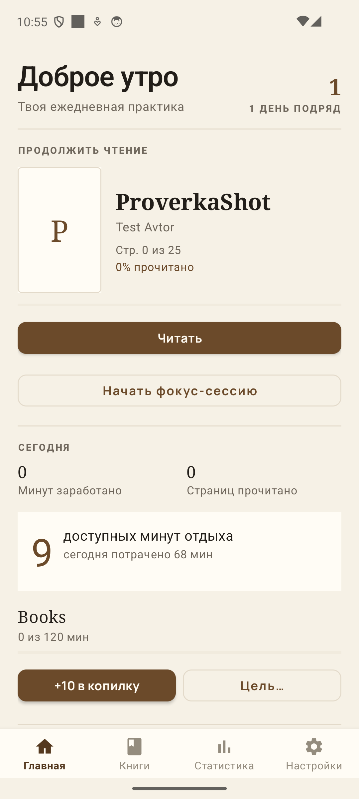
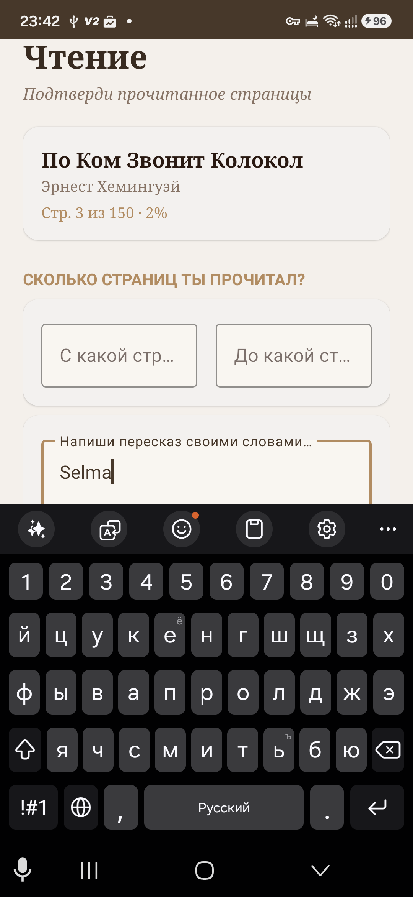

# Anti-SDVG (анти-СДВГ)

Native **Kotlin Android**-приложение, которое помогает справиться с прокрастинацией: блокирует соцсети (YouTube, TikTok и др.), пока вы не читаете книги. Чтение проверяется ИИ (DeepSeek), заработанные минуты копятся в «кошельке развлечений» и тратятся на разблокировку заблокированных приложений.

> **SDVG** — сленговая аббревиатура «синдрома дефицита внимания и гиперактивности» (СДВГ). Приложение — анти-версия: превращает желание «полистать ленту» в мотивацию почитать.

---

## Идея

Вы сами решаете, какие приложения отвлекают (TikTok, YouTube, игры…). Дальше схема простая:

1. **Читаете** книгу, 1 страница = фиксированное время (настраивается, по умолчанию 3 мин).
2. **Подтверждаете чтение** — пересказываете прочитанное, а DeepSeek проверяет «по смыслу» и ставит оценку 0–10.
3. **Зарабатываете минуты** в «кошелек развлечений».
4. **Тратите** заработанное время на заблокированные приложения.

Если баланс заработанного времени закончился и вы открываете заблокированное приложение — поверх появляется блокировочный оверлей. Из него можно потратить **аварийный «огонёк»** (+10 мин), который начисляется по одному за сессию.

## Ключевые возможности

- **Блокировка отвлекающих приложений** через `AccessibilityService` (не UsageStatsManager) с персистентным оверлеем.
- **Проверка чтения ИИ (DeepSeek)** — пересказ с разбором (герои/события/вывод) или быстрая оценка «по смыслу»; строгость Мягко/Нормально/Строго в настройках, опциональная цитата как доказательство; квиз генерируется отдельно и проверяется локально (2 из 3).
- **Таймер траты:** минуты списываются ежесекундно во время использования заблокированного приложения; при 0 → grace-окно 5 минут → блокирующий оверлей.
- **Форматы книг:** `Бумажная` (×1.0) и `Электронная` (×0.6) — влияют на заработанное время за страницу.
- **Авто-подстановка книги по ISBN** и **по ссылке из Яндекс.Книг** (Google Books → фоллбэк Open Library; Яндекс — только title/author/publisher).
- **Сканирование ISBN-кода камерой** через ML Kit Barcode Scanning + CameraX.
- **Экран статистики:** остаток минут (live), заработанное за день, график последних 7 дней, кошелёк и аварийные токены.
- **Аварийные «огоньки»:** старт 3, +1 за сессию, 1 огонёк = 10 мин экстренного доступа.
- **Фокус-сессии Pomodoro 25/5:** завершённый блок приносит минуты 1:1, счётчик в статистике.
- **Экономика:** дневной лимит трат, копилка на цель (откладывай по 10 мин, разбивай обратно), виджет кошелька на рабочий стол.
- **Встроенная читалка (FB2/TXT, в т.ч. `.fb2.zip`):** импорт книги прямо в приложение, два режима чтения — **постранично вправо** (свайп или тап по краям экрана) и **лента вниз**, четыре темы (бумага/сепия/ночь/чёрная), три шрифта (с засечками/без/моно), размер шрифта и переносы для русского. Авто-счёт времени чтения (только пока экран включён и нет простоя — вставший таймер так и подписан «пауза») и **реальных страниц** вёрстки («стр. 3 из 6»; это же число уезжает в карточку книги), закладка позиции с автосохранением. В конце сессии — **лёгкий тест** по прочитанному куску (пропущенное слово, 4 варианта из того же текста, офлайн): без него минуты не начисляются.
- **Достижения** (достижения за регулярное чтение).

## Скриншоты

| Главный экран | Проверка чтения |
|---|---|
|  |  |

## Стек

| Слой | Технология |
|------|-----------|
| Язык / UI | Kotlin, MVVM + Clean Architecture, ViewModel + StateFlow, View Binding |
| локальная БД | Room 2.6 (KSP), сущности книги/сессии/кошелька/блокировок и т.д. |
| ИИ-проверка | DeepSeek API (Retrofit + OkHttp, OpenAI-совместимый чат) |
| Книги | Google Books API + Open Library + Яндекс.Книги парсер |
| ISBN-скан | CameraX + ML Kit Barcode Scanning |
| Платформа | minSdk 24, targetSdk 34, compileSdk 34 |

## Структура пакета

```
app/src/main/java/com/antisdvg/
├── AntiSdvgApp.kt          # Application
├── data/
│   ├── local/              # AppDatabase, AppDao (Room)
│   ├── model/              # Book, ReadingSession, Wallet, Achievement, ...
│   ├── remote/             # DeepSeek/GoogleBooks клиенты + DTO
│   └── repository/         # DataRepository, AIRepository (DeepSeek-проверка)
├── service/
│   └── BlockerService.kt   # AccessibilityService: оверлей, таймер траты, огоньки
├── ui/                     # Activity + Fragments + ViewModels
│   └── reader/             # ReaderActivity/ViewModel: встроенная читалка FB2/TXT
└── util/                   # TimeCalculator, BookText (FB2/TXT), ClozeQuiz, валидация и др.
```

## Сборка

Нужен JDK 21; wrapper уже в репозитории (`gradlew.bat`).

Короткая команда — собрать и положить APK в одну понятную папку `release\`:

```bash
.\gradlew.bat :app:apk
# release\Анти-СДВГ.apk
# release\Анти-СДВГ-ГГГГ-ММ-ДД.apk
```

Обычная сборка по-прежнему кладёт APK в `app\build\outputs\apk\debug\`:

```bash
.\gradlew.bat :app:assembleDebug
```

Ключевые настройки:

- `minSdk 24`, `targetSdk 34`, `compileSdk 34`.
- **DEEPSEEK_API_KEY** задаётся в `gradle.properties` и инжектится в `BuildConfig` только при сборке. Реального ключа в репозитории **нет** — поставьте его локально.
- Компиляция Kotlin/JVM `17`.

## Запуск на устройстве

1. Собрать и установить `release\Анти-СДВГ.apk` (или свежий APK из `app\build\outputs\apk\debug\`).
2. В приложении: включить переключатель **«Блокировка»**, дать разрешения:
   - **Спец. возможности → «Установленные сервисы» → Anti-SDVG** (сам блокер),
   - **«Поверх других приложений»** (оверлей блокировки) — через кнопку в настройках.
3. Добавить заблокированные приложения (список) — они станут «платными».
4. Добавить книгу (вручную / по ISBN / по ссылке из Яндекс.Книг / сканом камеры / **импортом FB2 или TXT**) — бумажную через форму, электронную кнопкой **«Импорт»** в библиотеке.
5. Читать: бумажную — вручную указать страницы и пересказать; электронную — **открыть во встроенной читалке**, она сама считает время и страницы, а в конце предложит лёгкий тест. Получить минуты → пользоваться разблокированным.

> ⚠️ **Force-stop убивает блокировку:** после принудительной остановки Android сам отключает сервис спецвозможностей — вернуть блокировку можно только вручную: Настройки → Спец. возможности → «Установленные сервисы» → Anti-SDVG → ВКЛ.

## Лицензия

MIT — см. [LICENSE](LICENSE).
