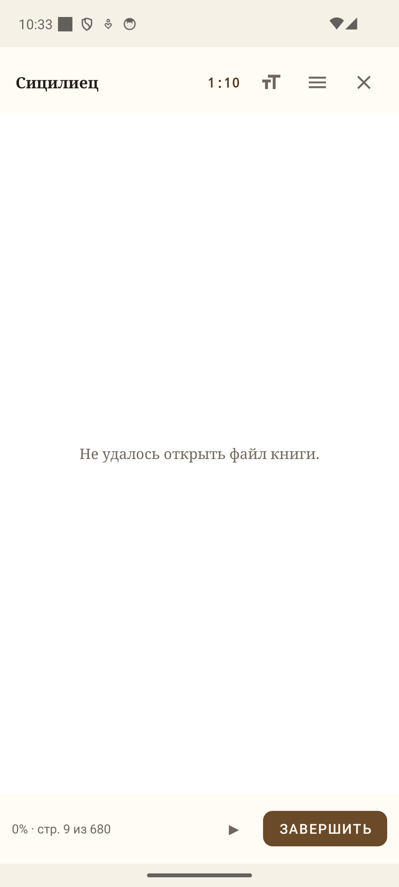

# Anti-SDVG (анти-СДВГ)

Native **Kotlin Android**-приложение, которое помогает справиться с прокрастинацией: блокирует соцсети (YouTube, TikTok и др.), пока вы не читаете книги. Чтение проверяется ИИ (DeepSeek), заработанные минуты копятся в «кошельке развлечений» и тратятся на разблокировку заблокированных приложений.

> **SDVG** — сленговая аббревиатура «синдрома дефицита внимания и гиперактивности» (СДВГ). Приложение — анти-версия: превращает желание «полистать ленту» в мотивацию почитать.

---

## Идея

Вы сами решаете, какие приложения отвлекают (TikTok, YouTube, игры…). Дальше схема простая:

1. **Читаете** книгу, 1 страница = фиксированное время (настраивается, по умолчанию 3 мин).
2. **Подтверждаете чтение** — пересказываете прочитанное, а DeepSeek проверяет «по смыслу» и ставит оценку 0–10.
3. **Зарабатываете минуты** в «кошелек развлечений».
4. **Тратите** заработанное время на заблокированные приложения.

Если баланс заработанного времени закончился и вы открываете заблокированное приложение — поверх появляется блокировочный оверлей. Из него можно потратить **аварийный «огонёк»** (+10 мин), который начисляется по одному за сессию.

## Ключевые возможности

- **Блокировка отвлекающих приложений** через `AccessibilityService` (не UsageStatsManager): видит только пакет активного приложения, содержимое экрана не читает. Оверлей «Минуты кончились» с кнопками «Читать сейчас», «Потратить огонёк», «Позже».
- **Таймер траты:** минуты списываются по начатым минутам, пока открыто заблокированное приложение; уход в другое приложение останавливает списание.
- **Проверка чтения ИИ (DeepSeek)** — вопросы по реальному тексту прочитанных страниц (1–5 по объёму). Каждый вопрос обязан цитировать фразу из отрывка, иначе отбрасывается; варианты перемешиваются. Строгость Мягко/Нормально/Строго меняет и промпт, и порог (½ / ⅔ / ¾). Офлайн-фолбэк — пропуски слов из того же текста; для бумажных книг — пересказ с голосовым вводом.
- **Экономика чтения:** электронная книга — 2 мин за страницу + 1 мин за минуту чтения + серия дней (до ×2); защита от пролистывания — не быстрее 2 страниц в минуту. Бумажная — 3 мин за страницу из настроек.
- **Фокус-сессия 30/5:** пока идёт фокус, заблокированные приложения закрыты независимо от кошелька; 30 минут дают 15 минут отдыха (2:1). Блок переживает перезапуск службы.
- **Аварийные «огоньки»:** старт 3, 1 огонёк = 10 мин экстренного доступа.
- **Дневной лимит трат, копилка** на цель (откладывай по 10 мин, разбивай обратно), **виджет кошелька**, **достижения** за регулярное чтение.
- **Встроенная читалка (FB2/TXT/EPUB, в т.ч. `.fb2.zip`):** два режима — **постранично вправо** (свайп/тап по краям) и **лента вниз**, четыре темы, три шрифта, кегль 80–200%, озвучка с автоперелистыванием, закладки, оглавление, поиск. Считает честное время (пауза при простое) и **реальные страницы** вёрстки. Перед тестом диапазон «с — по» можно поправить; вопросы и минуты идут по выбранным страницам.
- **Каталог бесплатных книг:** Викитека (русская классика), Project Gutenberg (английская), Флибуста (OPDS/FB2, поиск без учёта регистра и «ё»). Скачанное становится обычной книгой на полке.
- **Авто-подстановка книги по ISBN** и **по ссылке из Яндекс.Книг** (Google Books → фоллбэк Open Library).
- **Сканирование ISBN-кода камерой** через ML Kit Barcode Scanning + CameraX.
- **Статистика:** неделя / месяц / всё время, график по минутам, сводка.

## Скриншоты

| Главный экран | Читалка |
|---|---|
|  |  |

## Стек

| Слой | Технология |
|------|-----------|
| Язык / UI | Kotlin, MVVM + Clean Architecture, ViewModel + StateFlow, View Binding |
| локальная БД | Room 2.6 (KSP), сущности книги/сессии/кошелька/блокировок и т.д. |
| ИИ-проверка | DeepSeek API (Retrofit + OkHttp, OpenAI-совместимый чат) |
| Книги | Google Books API + Open Library + Яндекс.Книги парсер + каталоги (Викитека / Gutendex / Флибуста OPDS) |
| ISBN-скан | CameraX + ML Kit Barcode Scanning |
| Платформа | minSdk 24, targetSdk 34, compileSdk 34 |

## Структура пакета

```
app/src/main/java/com/antisdvg/
├── AntiSdvgApp.kt          # Application
├── data/
│   ├── local/              # AppDatabase, AppDao (Room)
│   ├── model/              # Book, ReadingSession, Wallet, Achievement, ...
│   ├── remote/             # DeepSeek/GoogleBooks клиенты + DTO
│   └── repository/         # DataRepository, AIRepository (DeepSeek-проверка)
├── service/
│   └── BlockerService.kt   # AccessibilityService: оверлей, таймер траты, огоньки
├── ui/                     # Activity + Fragments + ViewModels
│   └── reader/             # ReaderActivity/ViewModel: встроенная читалка FB2/TXT/EPUB
└── util/                   # TimeCalculator, BookText (FB2/TXT), ClozeQuiz, валидация и др.
```

## Сборка

Нужен JDK 21; wrapper уже в репозитории (`gradlew.bat`).

Короткая команда — собрать и положить APK в одну понятную папку `release\`:

```bash
.\gradlew.bat :app:apk
# release\Анти-СДВГ.apk
# release\Анти-СДВГ-ГГГГ-ММ-ДД.apk
```

Обычная сборка по-прежнему кладёт APK в `app\build\outputs\apk\debug\`:

```bash
.\gradlew.bat :app:assembleDebug
```

Ключевые настройки:

- `minSdk 24`, `targetSdk 34`, `compileSdk 34`.
- **DEEPSEEK_API_KEY** задаётся в `gradle.properties` и инжектится в `BuildConfig` только при сборке. Реального ключа в репозитории **нет** — поставьте его локально.
- Компиляция Kotlin/JVM `17`.

## Запуск на устройстве

1. Собрать и установить `release\Анти-СДВГ.apk` (или свежий APK из `app\build\outputs\apk\debug\`).
2. В приложении: включить переключатель **«Блокировка»**, дать разрешения:
   - **Спец. возможности → «Установленные сервисы» → Anti-SDVG** (сам блокер),
   - **«Поверх других приложений»** (оверлей блокировки) — через кнопку в настройках.
3. Добавить заблокированные приложения (список) — они станут «платными».
4. Добавить книгу (вручную / по ISBN / по ссылке из Яндекс.Книг / сканом камеры / **импортом FB2 или TXT**) — бумажную через форму, электронную кнопкой **«Импорт»** в библиотеке.
5. Читать: бумажную — вручную указать страницы и пересказать; электронную — **открыть во встроенной читалке**, она сама считает время и страницы, а в конце предложит лёгкий тест. Получить минуты → пользоваться разблокированным.

> ⚠️ **Force-stop убивает блокировку:** после принудительной остановки Android сам отключает сервис спецвозможностей — вернуть блокировку можно только вручную: Настройки → Спец. возможности → «Установленные сервисы» → Anti-SDVG → ВКЛ.

## Лицензия

MIT — см. [LICENSE](LICENSE).
